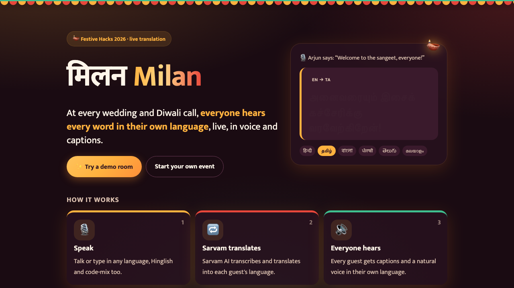
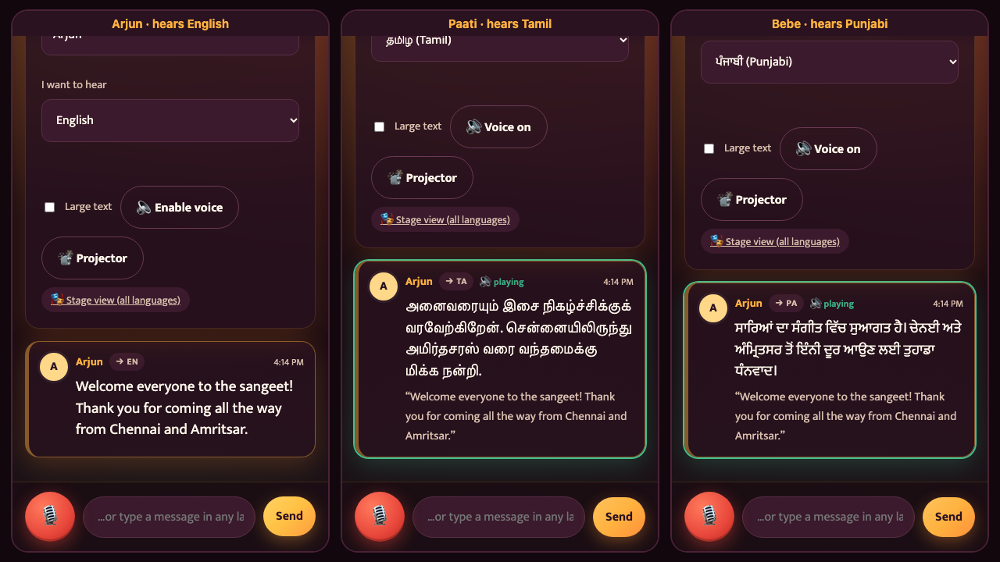
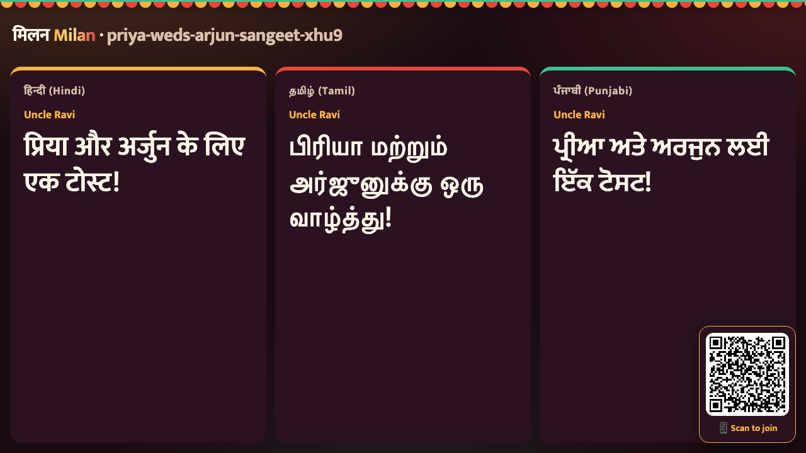

# मिलन Milan: every family speaks, every family understands

> Festive Hacks 2026 · WeMakeDevs × WeAreDevelopers · built with **Sarvam AI**, **Flagsmith** and **NudgeBee**

## Demo

* **Video (under 2 min):** see the link in the submission
* **Live demo:** https://easier-statements-replaced-upgrades.trycloudflare.com (temporary tunnel to the team's Kubernetes cluster; it's live only during judging)

| Landing | Three guests, three languages | Stage view |
|---|---|---|
|  |  |  |

## The problem
India's festive season brings families together who **don't share a language**: a Tamil
bride's family and a Punjabi groom's family at the sangeet, grandparents in Kolkata and
grandkids in Bengaluru on the Diwali video call. Speeches, jokes and blessings get lost, and
elders sit out.

## What Milan does
Milan is a **live multilingual room**. Guests scan a QR code and pick the language they want
to hear. Anyone speaks (or types) in *their* language, Hinglish and code-mixed speech
included, and every guest instantly gets **captions and a natural voice in their own
language**. There's also a **Stage view** (`/stage/<room>`) that shows every language side by side on the venue screen, a projector mode and a large-text mode for elders.

```
 🎙 speaker ─► Saaras STT ─► Sarvam-Translate ─┬─► ta-IN caption + Bulbul voice ─► Tamil guests
  (any lang)    (Sarvam)     (only languages   ├─► pa-IN caption + Bulbul voice ─► Punjabi guests
                              someone hears)   └─► …            (Redis fan-out across pods)
                     ▲                                  ▲
           Flagsmith flags (languages, voice,     NudgeBee watches k8s, scales pods +
           rush_mode, A/B voice, elder_mode)      flips rush_mode after human approval
```

## How each sponsor is used

| Sponsor | Role in Milan |
|---------|---------------|
| **Sarvam AI** | The core product. **Saaras v4** speech-to-text (auto language detection, code-mix) → **Sarvam-Translate** (22 Indian languages) → **Bulbul** text-to-speech. Translates *only* into languages someone in the room is listening in. |
| **Flagsmith** | Runs each event live with no redeploy: `enabled_languages` (remote config), `voice_output`, **`rush_mode`** kill switch (captions only), `tts_voice` **A/B experiment** (the room is the unit), `elder_mode` via a **segment** on trait `role = elder`. Server-side key = local evaluation: no flag latency on the hot path, and changes reach every pod in about 5 s. |
| **NudgeBee** | Milan runs on Kubernetes (kind). When the toast starts and hundreds of phones join, NudgeBee investigates the latency spike, then an **approval-gated workflow** scales the deployment **and** calls the Flagsmith API to turn on `rush_mode`, so the event heals itself. See [`nudgebee/WORKFLOW.md`](nudgebee/WORKFLOW.md). |

## Quick start (2 minutes, no keys)

```bash
python -m venv .venv && source .venv/bin/activate
make install
make mock            # http://localhost:8000  (fake Sarvam responses)
make test
```

Open `http://localhost:8000`, create a room, and open the room link in two tabs with
different languages.

## Real run

```bash
cp .env.example .env     # add SARVAM_API_KEY and FLAGSMITH_ENVIRONMENT_KEY (ser.…)
make dev
```

### Flagsmith setup
Create these features in your environment:

| Feature | Type / default |
|---------|----------------|
| `enabled_languages` | on, value `en-IN,hi-IN,ta-IN,bn-IN,te-IN,kn-IN,ml-IN,mr-IN,gu-IN,pa-IN` |
| `voice_output` | on |
| `rush_mode` | off |
| `tts_voice` | on, value empty (default voice). Make it **multivariate** with Bulbul speaker names to A/B test |
| `elder_mode` | off; add a segment override `role == elder` → on |

If Flagsmith is down, Milan uses safe built-in defaults. The event never breaks because of flags.

## Kubernetes + NudgeBee

```bash
make kind-up        # kind cluster, Milan exposed on http://localhost:8080
make deploy         # builds image, creates secret from .env, deploys Redis + Milan
make spike          # 200 guests + burst of messages → watch latency climb
```

Then follow [`nudgebee/WORKFLOW.md`](nudgebee/WORKFLOW.md) to connect the cluster and build
the **Sangeet Rush** workflow. Manual fallback: `make rush-on` / `make rush-off`.

**Observability:** `/metrics` (Prometheus) exposes `milan_utterance_seconds`,
`milan_sarvam_request_seconds{api}`, `milan_sarvam_inflight`, `milan_ws_connections` and
`milan_rush_mode`. Probes are at `/healthz` and `/readyz`.

## Architecture notes
* **FastAPI + WebSockets**, one stateless pod image. **Redis pub/sub** fans out events across
  replicas, and Redis hashes track which languages each room needs.
* **Back-pressure:** a per-pod semaphore caps concurrent Sarvam calls. Under load, calls queue
  visibly in the metrics instead of failing.
* **Failure isolation:** if one language's translation or voice fails, those guests get the
  original text and nobody else is affected. Retries use exponential backoff on 429/5xx.
* **Security:** non-root, read-only filesystem, secrets only via env/Secret, input size limits,
  room-id validation.

```
app/
  main.py      routes, WebSocket endpoint
  pipeline.py  STT → translate → TTS → publish
  sarvam.py    Sarvam REST client + offline mock
  flags.py     Flagsmith facade + defaults
  broker.py    in-memory / Redis fan-out
  hub.py       per-pod listener registry, flag push
static/        vanilla JS UI (no build step), WAV recorder
k8s/           kind config, Redis, Milan deployment/service
nudgebee/      self-healing workflow guide
scripts/       spike.py load generator
ops/           flagsmith_toggle.py (Management API)
```

## AI assistance disclosure
Following rule 7, I'm disclosing that this project was built with an AI coding assistant
(Claude by Anthropic). It helped with scaffolding, code and docs. I reviewed, ran and tested
the code and can explain every part of it.

## License
MIT
